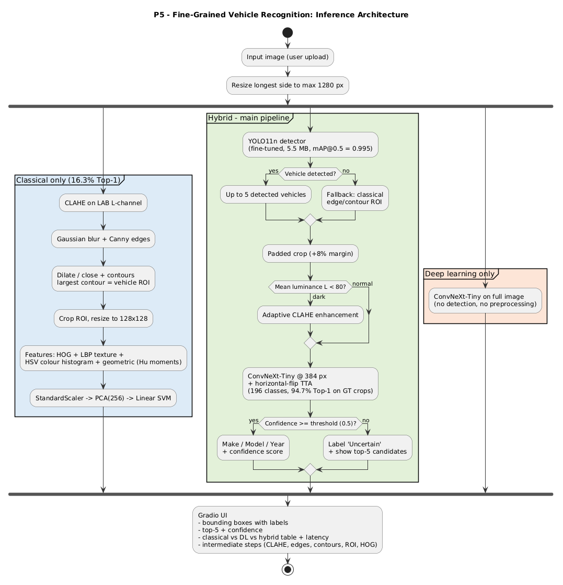
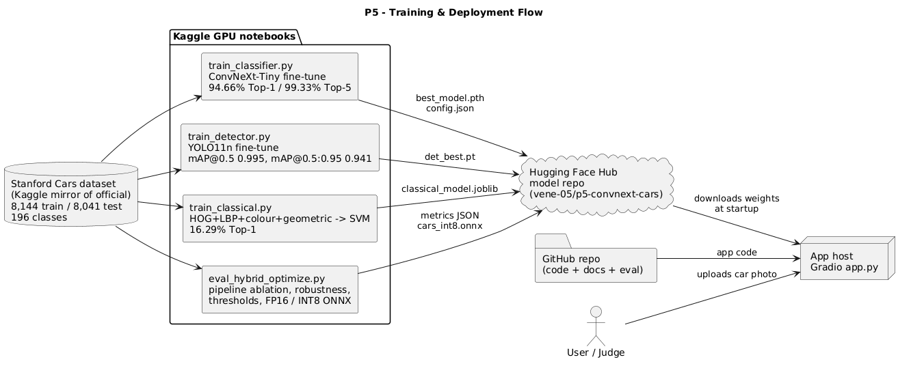

# Intelligent Fine-Grained Vehicle Recognition (CV Hackathon 2026 · P5 · Team T88 · Tech Titans)

Detects cars in an image and identifies their **make, model and year** across the 196 classes of the
Stanford Cars dataset. The system is a hybrid of classical computer vision and deep learning.

**Live app:** https://huggingface.co/spaces/vene-05/p5-vehicle-recognition
**Trained models:** https://huggingface.co/vene-05/p5-convnext-cars
**Evaluation results:** [`eval_P5_T88.md`](eval_P5_T88.md) · **Design document:** [`docs/design_document.md`](docs/design_document.md)



## Results (official test set, 8,041 unseen images)

| Approach | Top-1 | Top-5 |
|---|---|---|
| Classical (CLAHE → HOG + LBP + HSV colour + geometric → PCA → Linear SVM) | 16.29% | 35.74% |
| Deep learning only (ConvNeXt-Tiny on the full image) | 91.92% | 98.53% |
| **Hybrid (YOLO11n → padded ROI → adaptive CLAHE → ConvNeXt-Tiny + TTA)** | **94.71%** | **99.28%** |

| Detection (YOLO11n fine-tuned) | Value |
|---|---|
| mAP@0.5 / mAP@0.5:0.95 | 0.995 / 0.941 |
| Mean IoU (fine-tuned vs COCO zero-shot) | 95.39% vs 86.81% |

Optimization: FP16 halves model size and GPU memory with no accuracy loss. INT8 dynamic quantization
makes the classifier 3.9× smaller (112 → 28 MB) with no accuracy loss. Full metrics, robustness,
confidence-threshold analysis and ablations are in [`eval_P5_T88.md`](eval_P5_T88.md).

## Using the app

1. Open the live app and wait for **Ready**. The first visit downloads the models (about 120 MB on laptops, 40 MB on phones); later visits load from the browser cache.
2. Upload a car photo and press **Recognize**.
3. The app shows:
   - a box around each car with make, model, year and confidence
   - the top-5 candidates
   - the classical vs deep learning vs hybrid comparison
   - the latency of each stage
   - intermediate steps: CLAHE, Canny edges, contours/ROI, the classifier crop and gradients

Predictions below the confidence threshold (default 0.5) are shown as **Uncertain**.
## Training and deployment


## Repository structure

```
app/          Gradio app (app.py, features.py), requirements, Dockerfile (local / Docker version)
web/          Browser app (index.html) deployed to the HF Static Space
classifier/   train_classifier.py   ConvNeXt-Tiny fine-tuning (Kaggle GPU)
detection/    train_detector.py     YOLO11n fine-tuning + IoU/mAP evaluation (Kaggle GPU)
classical/    train_classical.py    classical features + SVM baseline and feature ablation (Kaggle CPU)
              features.py           shared classical CV functions
eval/         eval_hybrid_optimize.py  pipeline ablation, robustness, thresholds, FP16/INT8/ONNX
              failure_analysis.py      confusion pairs, worst classes, confident mistakes
              results/                 metric files
              unseen_images/           internet test images + sources
docs/         architecture and deployment diagrams (.puml + .png), design document, failure analysis
Dockerfile    builds the Gradio app from the repo root
eval_P5_T88.md   evaluation results in the required format
```

## Reproducing the results

All training ran on Kaggle (free T4 GPU). Each script is self-contained and can be pasted into one notebook cell.

**Kaggle inputs (both datasets):**
- `eduardo4jesus/stanford-cars-dataset`: images and devkit
- `abdelrahmant11/standford-cars-dataset-meta`: `cars_test_annos_withlabels.mat`, the test labels

**Settings:** turn Internet ON. Attach an `HF_TOKEN` secret only if you want automatic uploads.

| Step | Script | Hardware | Time | Output |
|---|---|---|---|---|
| 1 | `classifier/train_classifier.py` | GPU T4 ×2 | ~25 min | `best_model.pth`, `metrics.json`, `test_predictions.csv` |
| 2 | `detection/train_detector.py` | GPU T4 | ~35 min | `det/weights/best.pt`, `det_metrics.json` |
| 3 | `classical/train_classical.py` | CPU | ~20 min | `classical_model.joblib`, `classical_metrics.json` |
| 4 | `eval/eval_hybrid_optimize.py` | GPU T4 | ~40 min | `hybrid_metrics.json`, `optimization_metrics.json`, `cars_int8.onnx` |
| 5 | `eval/failure_analysis.py` | CPU | ~2 min | `failure_analysis.json`, figures |

All scripts use the same stratified 90/10 train/validation split (seed 42). The official test set is used only for final evaluation.

## Running locally

**Gradio app** (Python 3.11 or 3.12; 3.14 is not supported by Gradio yet):

```bash
cd app
python -m venv venv
venv\Scripts\activate          # Windows  (macOS/Linux: source venv/bin/activate)
pip install -r requirements.txt
python app.py                  # open http://localhost:7860
```

**Docker (one command)** from the repo root:

```bash
docker build -t p5-cars . && docker run -p 7860:7860 p5-cars
```

**Browser app:** open `web/index.html` through any static web server, e.g. `python -m http.server` inside `web/`.

Models download automatically from the Hugging Face repo. No secrets are needed to run anything.

## Limitations

- Only the 196 Stanford Cars classes are known (mostly US-market cars, model years up to 2012). Other cars are mapped to the nearest known class, so low-confidence predictions are flagged as Uncertain.
- The hardest cases are model years with near-identical styling, very low resolution (59% Top-1) and heavy blur (75%).
- The live browser app shows the classical pipeline's steps live, but reports its SVM accuracy from the offline evaluation. The Gradio app runs the classical SVM live.
- No number-plate recognition or vehicle tracking, as specified by the problem statement.

See the design document for full details, ethics and the team's contributions.

## Team T88 · Tech Titans

1RUA24CSE0528 · 1RUA24CSE0551 · 1RUA24CSE0516 · 1RUA24CSE0527
