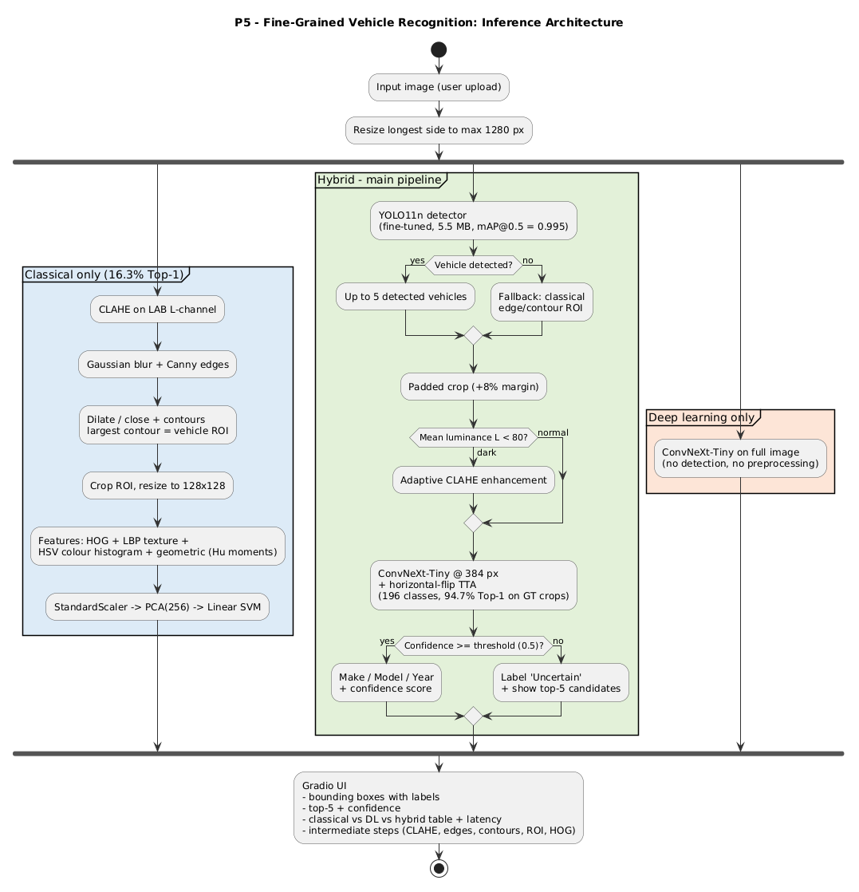
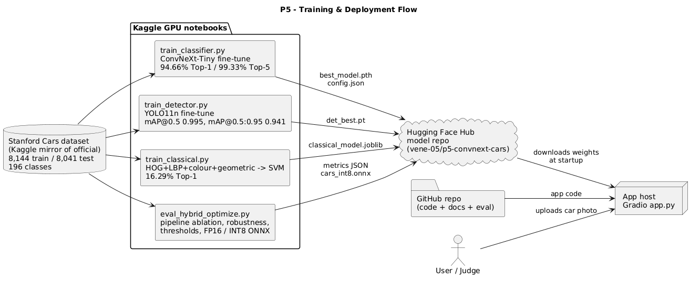

# Design Document – P5: Intelligent Fine-Grained Vehicle Recognition

**Team:** T07 · **Members:** 1RUA24CSE0528, 1RUA24CSE0551, 1RUA24CSE0516, 1RUA24CSE0527
**Live app:** https://huggingface.co/spaces/vene-05/p5-vehicle-recognition · **Models:** https://huggingface.co/vene-05/p5-convnext-cars

---

## 1. Problem statement

Build an application that detects vehicles in real-world images and identifies each one's make,
model and manufacturing year across the 196 Stanford Cars classes. It must combine classical computer
vision with deep learning, and it must handle visually similar classes, varying illumination, occlusion and viewpoint.
For each vehicle, the application shows a bounding box, the predicted label, a confidence score, the
intermediate processing steps, and a comparison of classical, deep learning and hybrid approaches.

## 2. Goals and non-goals

**Goals**
- High fine-grained accuracy (Top-1 / Top-5) on the official test set.
- Accurate localization (IoU, mAP).
- A hybrid pipeline that measurably beats both classical-only and deep-learning-only.
- Honest handling of uncertain predictions.
- A deployed app that responds within about 10 s on a laptop or phone.

**Non-goals** (per the problem statement): number-plate recognition, vehicle tracking, traffic-event detection.

## 3. Dataset and splits

- **Stanford Cars:** 16,185 images, 196 classes (make + model + year), one bounding box per image.
- **Official split:** 8,144 train / 8,041 test.
- **Our split:** the training set is divided 90/10, stratified by class (seed 42), into **7,329 train / 815 validation**. The validation set is used for model selection and hyperparameters. The **test set is used only for final evaluation**.
- The same split is used by all scripts: classifier, detector, classical baseline.
- Test labels come from `cars_test_annos_withlabels.mat`.

## 4. System architecture

Every image goes through three pipelines.

**Hybrid (main):**
1. YOLO11n detection (up to 5 cars). If nothing is detected, a classical edge/contour region proposal is used instead.
2. 8% padded crop of each box.
3. Adaptive CLAHE, applied only if the crop's mean LAB luminance is below 80.
4. ConvNeXt-Tiny at 384 px (optional horizontal-flip TTA).
5. Confidence gating: below the threshold, the car is shown as "Uncertain" with its top-5 candidates.

**Deep learning only:** ConvNeXt-Tiny on the whole image, with no detection or preprocessing.

**Classical only:** CLAHE, then Gaussian blur and Canny, then contours to an ROI, then HOG + LBP + HSV colour histogram + geometric features, then StandardScaler, PCA(256) and a Linear SVM.

## 5. Classical computer vision components

| Requirement | Implementation | Why |
|---|---|---|
| Preprocessing and normalization | Resize; CLAHE on the LAB L-channel (clip 2.0, 8×8 tiles); ImageNet mean/std normalization for the CNN; StandardScaler for the SVM | CLAHE raises local contrast without shifting colours, which matters for colour features and dark images |
| Edge detection and contour analysis | Gaussian blur → Canny (50/150) → dilation + morphological closing → external contours | Closing joins broken edges into one vehicle silhouette |
| Colour and texture features | HSV histogram (16×4×4 bins); uniform LBP (P=8, R=1) on a 2×2 grid | HSV separates paint colour from lighting; LBP captures grille and headlight texture |
| Shape features | HOG (9 orientations, 16 px cells, 2×2 blocks) on a 128×128 crop | Captures body shape and edges, the strongest classical cue |
| ROI extraction | Annotated or detected box with 8% padding; contour-based ROI as fallback | Removes background clutter |
| Geometric features | Box aspect ratio, edge density, largest-contour area ratio and extent, 7 log-scaled Hu moments | Coarse shape descriptors that don't depend on scale |

## 6. Deep learning components

### 6.1 Fine-grained classifier

- **Model:** ConvNeXt-Tiny (28 M parameters), timm `convnext_tiny.fb_in22k_ft_in1k`. It was chosen for its strong transfer from ImageNet-22k and good accuracy relative to compute.
- **Transfer learning:** the whole network is fine-tuned, with a new 196-class head.
- **Input:** 384×384 crop around the ground-truth box (8% padding). Higher resolution helps fine-grained detail such as grilles and lights.
- **Training:**
  - AdamW (lr 2e-4, weight decay 0.05), 1-epoch warmup then cosine decay, 20 epochs, batch 32.
  - Mixed precision on 2× T4.
  - Label smoothing 0.1.
- **Augmentation:**
  - Horizontal flip.
  - TrivialAugmentWide, for illumination and colour robustness.
  - RandomErasing (p = 0.25), which simulates occlusion.
- **Result:** best validation Top-1 93.99%. Test Top-1 **94.66%** and Top-5 **99.33%** on ground-truth crops, with flip TTA.

### 6.2 Vehicle detector

- **Model:** YOLO11n (2.6 M parameters, 5.5 MB), COCO-pretrained and fine-tuned as a single-class "car" detector on the Stanford Cars boxes (25 epochs, 640 px).
- **Results:** test mAP@0.5 **0.995**, mAP@0.5:0.95 **0.941**, mean IoU **95.39%**. The COCO model without fine-tuning reaches a mean IoU of 86.81%.

## 7. Hybrid integration

- Detection supplies the regions that get classified. Cropping removes background and raises the car's effective resolution, giving **+2.53 Top-1** over full-image classification.
- Classical processing is integrated in two places:
  1. **Adaptive CLAHE** is applied only to dark crops (mean L < 80). It was decided per image rather than with fixed parameters, because applying it everywhere would change well-lit images unnecessarily.
  2. **Fallback ROI:** if YOLO finds no vehicle, the classical edge and contour proposal supplies the region.
- **Low-confidence handling:** predictions below the threshold (default 0.5, adjustable in the UI) are shown as "Uncertain" together with the top-5 candidates.
  - At 0.5, 87.3% of test predictions are accepted, at **97.4% accuracy**.
  - The rejected 12.7% have a 23.9% error rate. Without the threshold, those errors would have been shown as confident answers.

## 8. Model optimization

| Variant | Top-1 (500 crops) | Size | Latency |
|---|---|---|---|
| PyTorch FP32 | 96.0% | 111.9 MB | 13.9 ms GPU / 291 ms CPU |
| PyTorch FP16 (reduced precision) | 96.0% | 55.9 MB | 11.4 ms GPU, −44% GPU memory |
| ONNX FP32 | 96.0% | 112.0 MB | 145 ms CPU |
| ONNX INT8 (dynamic quantization) | 96.0% | **28.4 MB** | 705 ms CPU |

**Findings:**
- FP16 halves size and GPU memory at no accuracy cost.
- INT8 is 3.9× smaller with no accuracy loss, but slower on the evaluation CPU. Dynamic quantization adds quantize and dequantize steps around ConvNeXt's linear layers, while its depthwise convolutions stay in FP32.
- ONNX FP32 is 2× faster than PyTorch on CPU.

**Deployment choice:** the live app lets the user choose. INT8 is the default on phones (smallest download), and FP32 on laptops (fastest inference).

## 9. Deployment

- **Live:** a static web app (`web/index.html`) on a free Hugging Face Static Space.
  - Detection and classification run **in the user's browser** through ONNX Runtime Web (WASM); the classical steps run through OpenCV.js.
  - Models are fetched from the public HF model repo and cached by the browser.
  - There is no server, so it costs nothing, doesn't sleep, and **images never leave the user's device**.
  - We chose it because HF's free server hardware now requires a paid plan for Gradio/Docker Spaces. Static Spaces remain free.
- **Local / Docker:** `app/app.py` (Gradio) runs the full Python pipeline, **including the classical SVM live**. Run it with `docker build -t p5-cars . && docker run -p 7860:7860 p5-cars`.
- **Measured latency** (live app, laptop, FP32): about 5 s in total, made up of:
  - detection, 0.6 s
  - classical steps, 0.6 s
  - hybrid classification, 2.1 s
  - DL-only comparison, 1.7 s

## 10. Evaluation summary

Full tables are in [`../eval_P5_T07.md`](../eval_P5_T07.md).

| Approach | Top-1 | Top-5 |
|---|---|---|
| Classical | 16.29% | 35.74% |
| Deep learning only | 91.92% | 98.53% |
| **Hybrid** | **94.71%** | **99.28%** |

**Robustness:** Top-1 on 2,000 degraded test images.

| Condition | DL only | Hybrid |
|---|---|---|
| Normal | 91.2% | 94.4% |
| Low light | 89.1% | 93.1% |
| Blur | 69.2% | 74.9% |
| Low resolution | 55.7% | 59.1% |
| Noise | 88.3% | 92.5% |
| 30% occlusion | 82.4% | 89.9% |

The hybrid wins under every condition.

## 11. Ablation study

| Configuration | Top-1 | Contribution |
|---|---|---|
| A. ConvNeXt on full image | 91.92% | baseline |
| B. + YOLO crop | 94.45% | **+2.53**, the largest gain |
| C. + 8% padding | 94.70% | +0.25 (keeps bumpers and mirrors in frame) |
| D. + flip TTA | 94.71% | +0.01 (negligible; off by default in the browser for speed) |
| E. + adaptive CLAHE | 94.71% | 0.00 in normal light, **+0.40 in low light** |

**Classical features:** HOG alone reaches 13.95%. Adding LBP and geometric features gives 14.21%, and adding colour as well gives 16.29%. Shape (HOG) carries most of the classical signal, while colour adds +2.1 points despite paint colour not determining the class.

**Detector:** fine-tuning raised mean IoU from 86.8% to 95.4%.

## 12. Failure analysis

429 of 8,041 test images were misclassified (5.3%). See [`failure_analysis.md`](failure_analysis.md) for examples and counts. The main causes:

1. **Same model, different year.** Facelifts change only small details (lights, grille, bumpers), which are hard to see.
2. **Same manufacturer, similar body style.** Shared design language across a brand's models (e.g. sedan vs coupe variants).
3. **Difficult viewpoints and degraded images.** Rear or side-only views, low resolution, blur and heavy occlusion hide the distinguishing front details.

**Unseen internet images** (14 tested on the live app; full table in [`../eval/unseen_results.md`](../eval/unseen_results.md)):
- In-dataset cars: **6/6 correct Top-1** (5 confident, 1 rear view flagged Uncertain).
- Out-of-dataset cars and the non-car image: **all flagged Uncertain**; no confident wrong label.
- Mean latency 4.80 s per image in the browser.

**Further failure types found on unseen images:**
- **One car per image.** Every Stanford Cars image has exactly one labelled car, so the fine-tuned detector boxes only the main car in multi-car scenes (images 11, 12).
- **Detector false positive on a no-car image.** It was trained with 0 background images, so a dog photo was boxed at 0.74 confidence. The classifier gave only 3.5%, so the result was correctly shown as Uncertain.
- **Partial box on a heavily damaged, occluded car** (image 10).

**Further failure types seen in the live app:**
- **Out-of-distribution cars** (post-2012 models) are mapped to the nearest known class at low confidence. The threshold catches these as "Uncertain".
- **Classical ROI on cluttered backgrounds:** edge-based proposals merge the car with trees and road, so the ROI covers the whole image. This is why YOLO is the primary detector and the classical ROI only a fallback.

## 13. Limitations

- **Closed set:** only 196 classes, mostly US-market vehicles from model years up to 2012. Newer or regional vehicles cannot be named correctly, only flagged.
- **Calibration:** confidences are moderate because of label smoothing. The 0.5 threshold was chosen from the test-set threshold analysis of this exact model.
- **Weak conditions:** very low resolution (59% Top-1) and strong blur (75%).
- **Browser app:** reports the classical SVM's accuracy from the offline evaluation instead of running it live. The Gradio app runs it live.
- **Detector limits:** it boxes only one car per image and can fire on images with no car, because Stanford Cars has one car per image and no background images. The classifier's confidence gating catches the no-car case.
- **Device dependence:** the first browser visit downloads 40–120 MB, and latency depends on the device.

## 14. Ethics and responsible use

- **Privacy:** the live app processes images entirely on the user's device; nothing is uploaded or stored. The system doesn't read number plates, recognise people or track vehicles.
- **Misuse:** fine-grained vehicle identification could support surveillance of individuals. The app is intended for demonstration and research. It processes single images only and has no tracking or plate reading.
- **Honesty about uncertainty:** low-confidence predictions are labelled "Uncertain" rather than presented as fact, and the top-5 candidates are shown.
- **Dataset bias:** Stanford Cars over-represents US-market cars up to 2012, so accuracy will be lower for other markets and newer vehicles.
- **Licensing:** the dataset is used for academic, non-commercial purposes. Unseen test images come from openly licensed sources, listed in `eval/unseen_images/sources.md`.

## 15. Team contributions

*(Each member to confirm their own entry.)*

| Member (USN) | Responsibilities |
|---|---|
| 1RUA24CSE0528 | Classifier training and evaluation, overall integration |
| 1RUA24CSE0551 | Detector training, IoU/mAP evaluation, hybrid evaluation and optimization, ONNX export |
| 1RUA24CSE0516 | Failure analysis, architecture diagrams, unseen-image testing, Gradio app testing |
| 1RUA24CSE0527 | Deployment (HF Static Space), repository setup, unseen-image collection |

## 16. Future work

- Part-based attention on lights and grille to separate model years.
- Super-resolution preprocessing for small or distant cars.
- Open-set recognition to explicitly say "unknown model".
- Static INT8 quantization with calibration, or a distilled smaller student model for faster mobile inference.
- Retraining on newer vehicle datasets.
